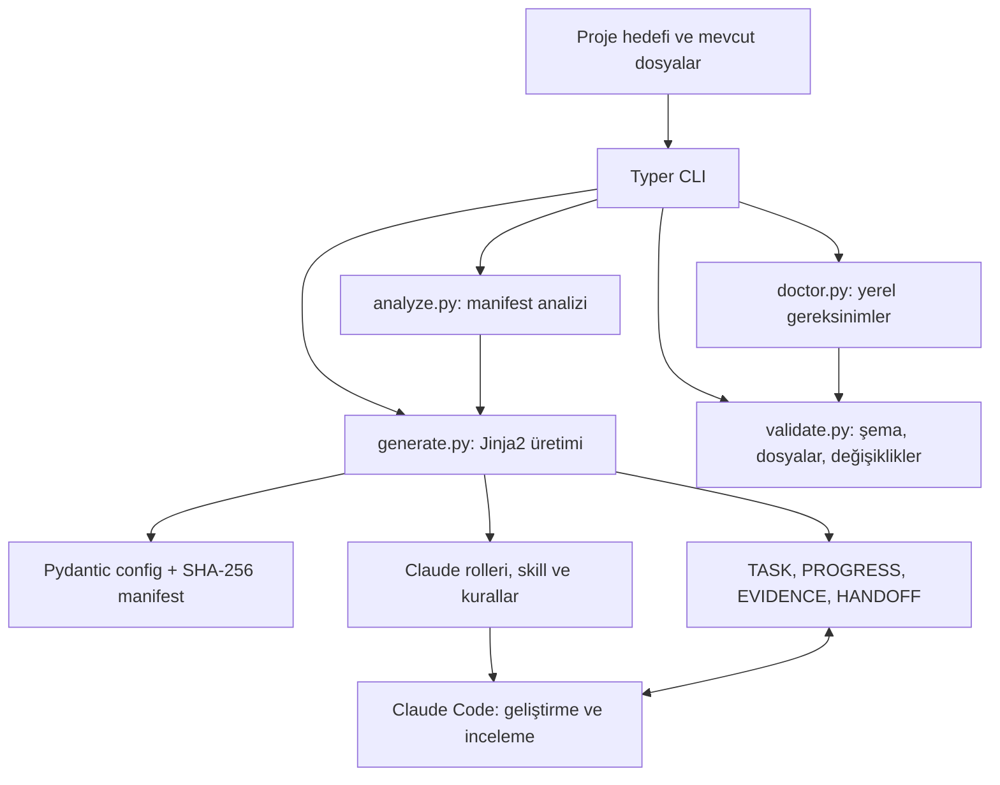

# Mimari

`cli.py` giriş/çıkış sözleşmesini, `models.py` sürümlü veri sözleşmelerini,
`filesystem.py` dosya sınırlarını içerir. Şablonlar Python wheel içine paketlenir;
kaynak repo dışında kurulu CLI da dosya üretebilir.

`init` önce bütün hedefleri kontrol eder. Mevcut dosyaları reddeder. Yazma sırasında
oluşan normal I/O hatalarında o çağrıda oluşturduğu dosya/dizinleri geri alır;
mevcut proje dosyalarını silmez. İşletim sistemi çökmesi veya aynı anda dizinleri
kötü niyetle değiştiren süreçlere karşı tam transactional filesystem garantisi yoktur.

`validate` manifestin sadece desteklenen dosyaları içermesine izin verir. Dosya
hash'leri değişiklik tespiti içindir; imza veya güvenlik onayı değildir. Kullanıcı
özelleştirmeleri hata değil uyarıdır; eksik dosya/geçersiz config hata üretir.

Şu an sürüm 0.1.0 ve config şeması 1 desteklenir. Tanınmayan sürüm kabul edilmez;
sürüm yükseltme migration'ları ayrı bir geliştirmedir. Metadata veri olarak tutulur;
CLI hiçbir proje komutunu yürütmez. Claude bu veriyi okuyacağı için dış içerik yine
ajan tarafından güvenilmeyen veri olarak ele alınmalıdır.
